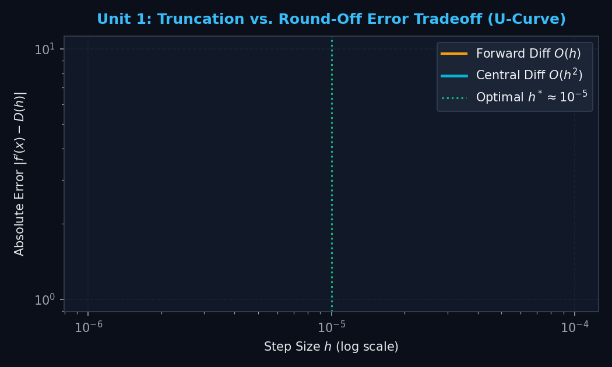
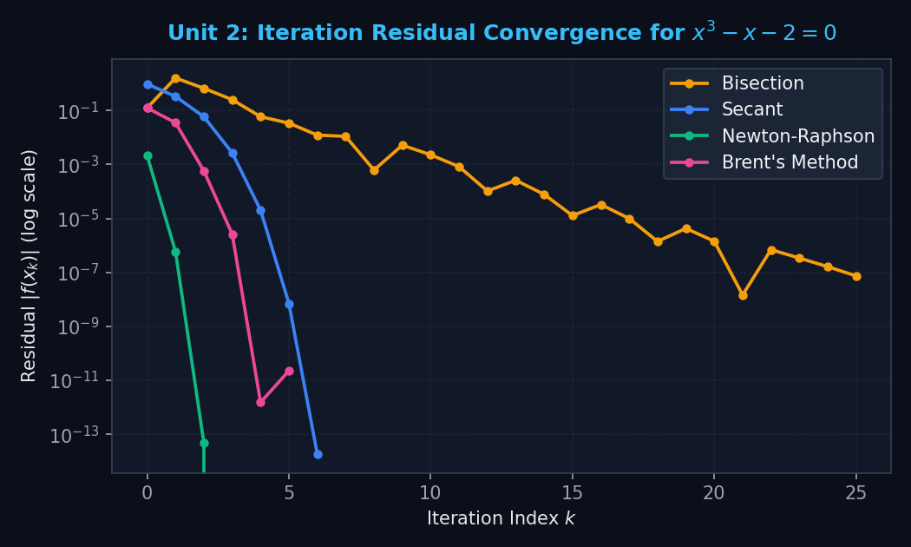
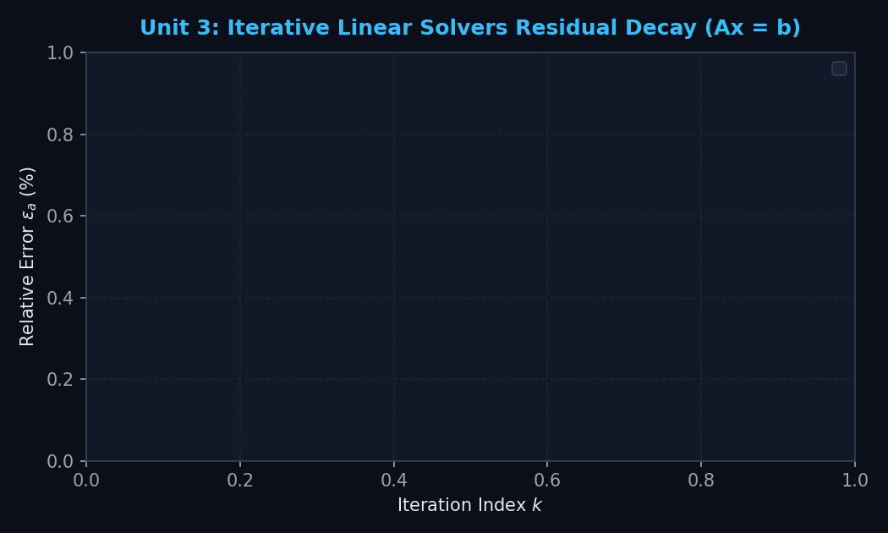
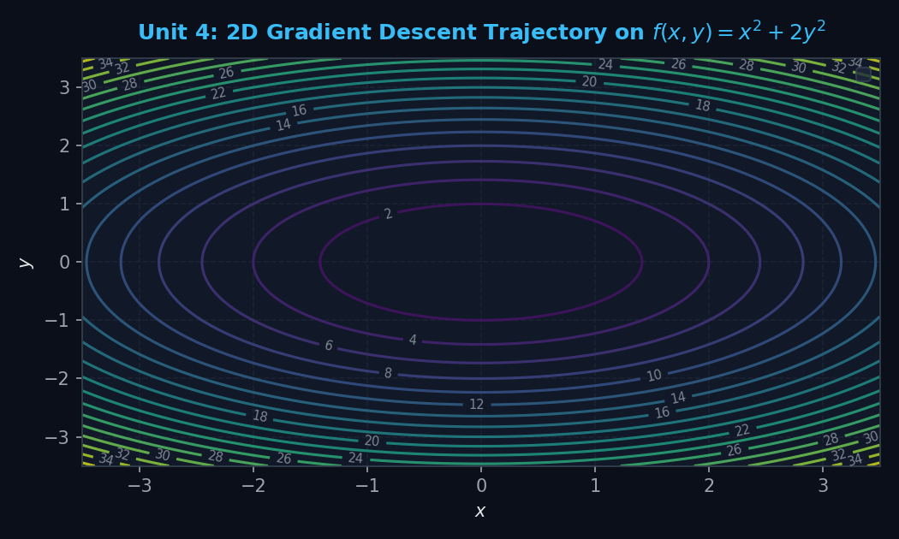
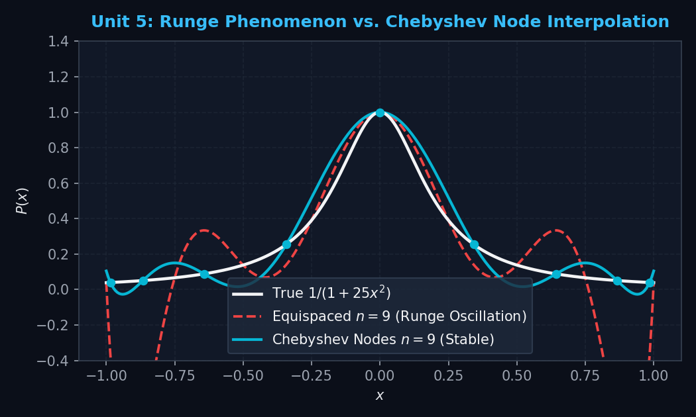
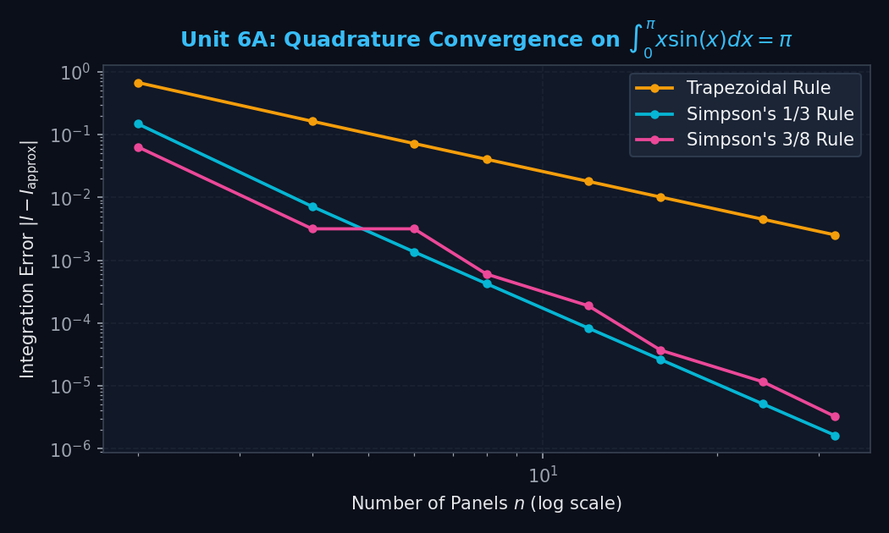
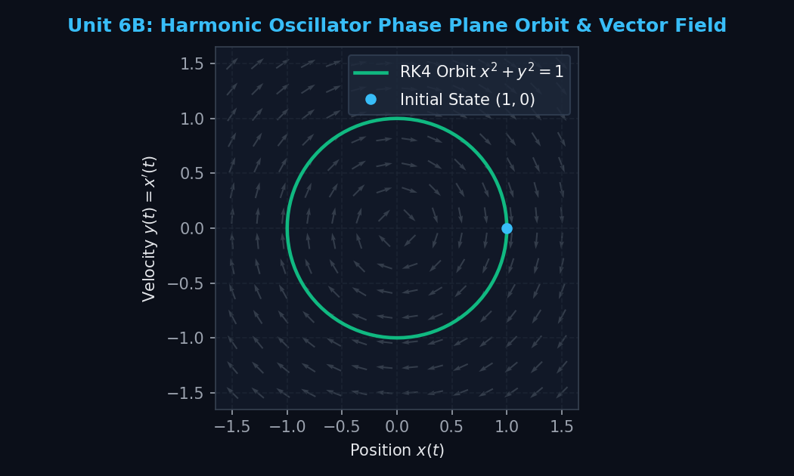

# ⚡ Numerical Analysis Suite — Complete 6-Unit Learning Platform
### 🔬 100% C-Powered Numerical Computation & Visual Interactive Learning Lab for Windows

<p align="center">
  <a href="https://github.com/SOMAJIT2005/Numerical-Visualizer/releases/latest"></a>
  
  
  
  
</p>

---

## 📖 Overview

The **Numerical Analysis Suite** is a full-featured, desktop numerical computing and educational platform designed for engineering and computer science students, researchers, and educators. 

All mathematical evaluations, matrix reductions, derivatives, step sweeps, optimization routines, quadrature schemes, and differential equation solvers are executed entirely in **statically compiled C binaries** (`-O3 -static`) with microsecond execution speeds and double-precision arithmetic. The desktop frontend is built using **Python, Tkinter, and Matplotlib**, providing real-time interactive plots, animated step-by-step matrix row operations, iteration tables, and formula substitutions.

> [!NOTE]  
> **100% Free & Open Access**: All previous 24-hour trial timers and activation gates have been permanently removed. The application ships fully unlocked with zero restrictions.

---

## 📥 Quick Start (Zero-Dependency Standalone Executable)

No Python, no MinGW/GCC compiler, and no dependencies are required to run the application on Windows:

1. Download **[`Numerical_Analysis_Suite.exe`](https://github.com/SOMAJIT2005/Numerical-Visualizer/releases/download/v2.0.0/Numerical_Analysis_Suite.exe)** from the latest [**GitHub Releases**](https://github.com/SOMAJIT2005/Numerical-Visualizer/releases/tag/v2.0.0).
2. Double-click the `.exe` to launch.
3. *Windows SmartScreen note*: If Windows displays a "Windows protected your PC" prompt, click **"More info"** &rarr; **"Run anyway"** (the binary is built from open-source code in this repository).

---

## 🌟 Key Platform Features

- ⚡ **100% Compiled C Engine Backend**: All numerical methods run via native subprocess bridges to `build/engine.exe`, `build/matrix_engine.exe`, and `build/numlab_engine.exe`.
- 📖 **Full Working Steps & Governing Equations**: Every method provides live theoretical formula banners and a **`📖 Full Working Steps & Equation`** modal detailing algebraic substitutions and arithmetic values for every iteration.
- 🎨 **Modern Responsive UI**: Dark & Light theme toggle (`🌙 Dark` / `☀ Light`), Segoe UI typography, and responsive two-column layouts with dedicated input controls and result cards.
- 📊 **Interactive Matplotlib Visualizations**: Pan, zoom, hover coordinate inspections, slope quivers, and 40×40 2D contour grids.
- 💾 **Workspace Session Persistence**: One-click **`💾 Save`** and **`📂 Load`** top-bar buttons to export and restore complete multi-tab lab states as JSON.
- ⚖ **Method Comparison Lab**: Benchmark multiple numerical methods on identical problems simultaneously to evaluate convergence rates and error profiles.
- 🎯 **Practice & Self-Test Quiz**: Interactive problem generator with automated verification and hints for exam preparation.
- 📚 **Full Syllabus Formula Guide**: In-app comprehensive formula reference covering all 6 units.

---

## 🔬 Syllabus Units & Detailed Method Specifications

### 🔬 Unit 1 — Numerical Approximations, Round-Off Errors & IEEE-754

<p align="center">
  
</p>

| Method / Tool | Governing Mathematical Equation | Description & Implementation |
|---|---|---|
| **Truncation vs. Round-Off Error Tradeoff ($h$-Sweep)** | $$f'(x_0) \approx \frac{f(x_0 + h) - f(x_0 - h)}{2h} + O(h^2)$$<br>$$E_{\text{total}}(h) \approx \frac{M}{6}h^2 + \frac{\varepsilon_{\text{mach}}}{h}$$ | Sweeps step size $h \in [10^{-16}, 10^0]$ in C. Visualizes the classic U-Curve tradeoff where Taylor truncation error dominates for large $h$ and IEEE-754 subtractive cancellation dominates for small $h$, identifying optimal $h^* \approx 10^{-5}$. |
| **Taylor Series & Truncation Remainder** | $$P_N(x) = \sum_{k=0}^N \frac{f^{(k)}(x_0)}{k!} (x - x_0)^k$$<br>$$R_N(x) = \frac{f^{(N+1)}(\xi)}{(N+1)!}(x - x_0)^{N+1}$$ | Evaluates successive Taylor polynomial orders up to degree $N=10$, comparing local polynomial approximations against exact transcendental values and quantifying Lagrange remainder bounds. |
| **Catastrophic Cancellation Lab** | Naive: $\sqrt{x^2 + 1} - x$<br>Rationalized: $\frac{1}{\sqrt{x^2 + 1} + x}$ | Demonstrates the loss of significant digits when subtracting two nearly equal floating-point numbers across $x = 10^0 \dots 10^8$, proving algebraic rationalization preserves precision. |
| **IEEE-754 64-Bit Float Inspector** | $$x = (-1)^S \times (1.M)_2 \times 2^{E - 1023}$$<br>$$\varepsilon_s = (0.5 \times 10^{2 - p})\%$$ | Bit-level C inspection dissecting a double into its 1-bit sign, 11-bit biased exponent, and 52-bit mantissa, alongside Scarborough's criterion for $p$ significant figures. |

---

### 📈 Unit 2 — Roots of Single-Variable Equations & Polynomials

<p align="center">
  
</p>

| Method | Order of Convergence ($\alpha$) | Governing Iterative Formula | Key Characteristics & Use Cases |
|---|:---:|---|---|
| **Bisection** | $\alpha = 1$ (Linear, $R = 0.5$) | $$c = \frac{a + b}{2}$$ | Unconditionally convergent bracketing method based on the Intermediate Value Theorem. |
| **False Position (Regula Falsi)** | $\alpha = 1$ | $$c = \frac{a \cdot f(b) - b \cdot f(a)}{f(b) - f(a)}$$ | Linear interpolation between bracket endpoints; retains one stagnant boundary point for convex curves. |
| **Brent's Method** | $\alpha \approx 1.618$ (Superlinear) | Inverse Quadratic Interpolation + Secant + Bisection fallback | State-of-the-art hybrid solver combining speed of open methods with guaranteed bracketing convergence. |
| **Newton-Raphson** | $\alpha = 2$ (Quadratic) | $$x_{k+1} = x_k - \frac{f(x_k)}{f'(x_k)}$$ | Fastest convergence for smooth functions with good initial guesses. Guards against $f'(x) \approx 0$. |
| **Modified Newton** | $\alpha = 2$ (Quadratic on multiple roots) | $$x_{k+1} = x_k - \frac{f(x_k) f'(x_k)}{[f'(x_k)]^2 - f(x_k) f''(x_k)}$$ | Restores quadratic convergence when solving multiple roots ($f(x^*) = 0, f'(x^*) = 0$) using $u(x) = f(x)/f'(x)$. |
| **Secant Method** | $\alpha \approx 1.618$ (Superlinear) | $$x_{k+1} = x_k - f(x_k) \frac{x_k - x_{k-1}}{f(x_k) - f(x_{k-1})}$$ | Eliminates analytical derivatives by approximating slopes with finite differences across two guesses. |
| **Modified Secant** | $\alpha \approx 1.618$ | $$x_{k+1} = x_k - \frac{\delta x_k f(x_k)}{f(x_k + \delta x_k) - f(x_k)}$$ | Uses a single starting point with fractional perturbation $\delta$ (default 0.01). |
| **Fixed-Point Iteration** | $\alpha = 1$ (if $|g'(x^*)| < 1$) | $$x_{k+1} = g(x_k)$$ | Rearranges $f(x)=0$ into $x=g(x)$; renders dynamic cobweb iteration paths. |
| **Horner's Method & Deflation** | $\alpha = 2$ | $$P(x) = (x - x_0) Q(x) + P(x_0)$$ | Synthetic division computing $P(x_0)$ and $P'(x_0)$ in $O(n)$ flops; deflates found roots iteratively to isolate all polynomial roots. |

---

### 🧮 Unit 3 — Systems of Linear Equations, Matrix Inversion & Diagnostics

<p align="center">
  
</p>

| Method / Diagnostic | Governing Formulation | Operation & Properties |
|---|---|---|
| **Gaussian Elimination** | $$m_{ik} = \frac{a_{ik}}{a_{kk}}, \quad R_i \leftarrow R_i - m_{ik} R_k$$ | Upper-triangular row reduction with partial pivoting, followed by back-substitution. Cost: $\frac{2}{3}n^3 + O(n^2)$. |
| **Gauss-Jordan Elimination** | $$R_k \leftarrow \frac{R_k}{a_{kk}}, \quad R_i \leftarrow R_i - a_{ik} R_k \; (i \neq k)$$ | Reduces augmented matrix $[A \mid b]$ directly to reduced row echelon form $[I \mid x]$. |
| **$PA = LU$ Decomposition** | $$A = L \cdot U, \quad L y = P b, \quad U x = y$$ | Doolittle factorization with unit lower-triangular $L$ and upper-triangular $U$; optimal for solving multiple RHS vectors. |
| **Gauss-Seidel Iteration** | $$x_i^{(k+1)} = \frac{1}{a_{ii}}\left(b_i - \sum_{j<i} a_{ij} x_j^{(k+1)} - \sum_{j>i} a_{ij} x_j^{(k)}\right)$$ | Successive replacement iterative solver. Guaranteed to converge if $A$ is strictly diagonally dominant or Symmetric Positive Definite (SPD). |
| **Jacobi Iteration** | $$x_i^{(k+1)} = \frac{1}{a_{ii}}\left(b_i - \sum_{j \neq i} a_{ij} x_j^{(k)}\right)$$ | Simultaneous displacement iterative solver where all updates use only previous-step values $x^{(k)}$. |
| **Matrix Inversion** | $$[A \mid I] \xrightarrow{\text{row ops}} [I \mid A^{-1}]$$ | Computes full matrix inverse via augmented Gauss-Jordan reduction; verifies residual $\|AA^{-1} - I\|_\infty \approx 0$. |
| **Matrix Diagnostics** | $\det(A)$, $\kappa_\infty(A) = \|A\|_\infty \|A^{-1}\|_\infty$, Sylvester's SPD | Classifies symmetry, strict diagonal dominance, condition number, and SPD criterion via leading principal minors. |

---

### 🎯 Unit 4 — 1D & 2D Unconstrained Optimization

<p align="center">
  
</p>

| Method | Type | Governing Formulation | Notes & Classification |
|---|:---:|---|---|
| **Golden-Section Search** | 1D Unimodal | $$d = \frac{\sqrt{5}-1}{2}(x_u - x_l) \approx 0.618034(x_u - x_l)$$ | Derivative-free bracketing method maintaining golden ratio spacing across iterations. |
| **Parabolic Interpolation** | 1D Open | $$x_3 = \frac{f_1(x_2^2 - x_3^2) + f_2(x_3^2 - x_1^2) + f_3(x_1^2 - x_2^2)}{2 f_1(x_2 - x_3) + 2 f_2(x_3 - x_1) + 2 f_3(x_1 - x_2)}$$ | Fits successive quadratics through 3 points to locate vertex extremum. |
| **1D Newton Optimization** | 1D Open | $$x_{k+1} = x_k - \frac{f'(x_k)}{f''(x_k)}$$ | Rapidly finds stationary points where $f'(x^*) = 0$; uses $f''(x^*)$ for Min/Max test. |
| **2D Gradient Descent** | 2D Multivar | $$\mathbf{x}_{k+1} = \mathbf{x}_k - \alpha \nabla f(\mathbf{x}_k)$$ | First-order steepest descent traversing orthogonal to function contour lines. |
| **2D Coordinate Descent** | 2D Multivar | $$x_{k+1} = \arg\min_x f(x, y_k), \quad y_{k+1} = \arg\min_y f(x_{k+1}, y)$$ | Alternates line minimization along individual coordinate axes without requiring gradient vectors. |
| **2D Multivariable Newton** | 2D Multivar | $$\mathbf{x}_{k+1} = \mathbf{x}_k - H^{-1}(\mathbf{x}_k) \nabla f(\mathbf{x}_k)$$ | Second-order method utilizing the full 2×2 Hessian matrix $H$. Computes eigenvalues $\lambda_1, \lambda_2$ and $\det(H)$ to classify **Local Minima** ($\det H > 0, f_{xx} > 0$), **Local Maxima** ($\det H > 0, f_{xx} < 0$), and **Saddle Points** ($\det H < 0$). |

---

### 📐 Unit 5 — Polynomial Interpolation & Curve Fitting

<p align="center">
  
</p>

| Method | Governing Mathematical Formula | Characteristics & Capabilities |
|---|---|---|
| **Newton's Divided Differences** | $$P_n(x) = f[x_0] + \sum_{k=1}^n f[x_0, \dots, x_k] \prod_{j=0}^{k-1} (x - x_j)$$ | Incremental interpolation; adding a new data point requires only computing one additional row in the tableau. |
| **Lagrange Polynomials** | $$P_n(x) = \sum_{i=0}^n y_i L_i(x), \quad L_i(x) = \prod_{j \neq i} \frac{x - x_j}{x_i - x_j}$$ | Explicit basis formulation without matrix inversion. |
| **Power / Monomial Basis** | $$V \mathbf{c} = \mathbf{y}, \quad V_{ij} = x_i^j, \quad P(x) = \sum_{j=0}^n c_j x^j$$ | Solves the Vandermonde linear system; reports condition number $\kappa_\infty(V)$ to demonstrate ill-conditioning for large $n$. |
| **Runge vs. Chebyshev Preset** | $$x_k = \cos\left(\frac{2k + 1}{2n}\pi\right), \quad k = 0, \dots, n-1$$ | Demonstrates Runge's divergence phenomenon on $f(x) = 1/(1+25x^2)$ with equidistant nodes versus optimal Chebyshev node placement. |
| **Inverse Interpolation** | Swap roles: $(y_i, x_i) \to P(y) \approx x$ | Inverts function coordinates to find $x^*$ corresponding to target $y^*$; validates strict monotonicity. |
| **Ordinary Least Squares (OLS)** | Minimize $S_r = \sum (y_i - a_0 - a_1 x_i)^2$<br>$$R^2 = \frac{S_t - S_r}{S_t}$$ | Fits linear and polynomial trends to experimental data; calculates correlation coefficient $R^2$, standard error of estimate $s_{y/x}$, and residuals. |

---

### ∫ Unit 6A — Numerical Quadrature (Integration)

<p align="center">
  
</p>

| Quadrature Rule | Panel Requirement | Degree of Exactness | Governing Quadrature Formula |
|---|:---:|:---:|---|
| **Trapezoidal Rule** | $n \ge 1$ | $1$ (Linear) | $$I \approx \frac{h}{2} \left[f(a) + 2\sum_{i=1}^{n-1} f(x_i) + f(b)\right]$$ |
| **Simpson's 1/3 Rule** | $n$ must be even | $3$ (Cubic) | $$I \approx \frac{h}{3} \left[f(a) + 4\sum_{\text{odd}} f(x_i) + 2\sum_{\text{even}} f(x_i) + f(b)\right]$$ |
| **Simpson's 3/8 Rule** | $n$ multiple of 3 | $3$ (Cubic) | $$I \approx \frac{3h}{8} \left[f(x_0) + 3\sum_{i \neq 3k} f(x_i) + 2\sum_{i = 3k} f(x_i) + f(x_n)\right]$$ |
| **Boole's Rule** | $n$ multiple of 4 | $5$ (Quintic) | $$I \approx \frac{2h}{45} \sum \left[7f_0 + 32f_1 + 12f_2 + 32f_3 + 7f_4\right]$$ |
| **Romberg Integration** | $2^k$ intervals | Up to $O(h^8)$ | $$R_{k,j} = R_{k, j-1} + \frac{R_{k, j-1} - R_{k-1, j-1}}{4^j - 1}$$ (Richardson extrapolation) |
| **Gauss-Legendre (2 to 5-pt)** | $n$ points | $2n - 1$ | $$I \approx \frac{b - a}{2} \sum_{i=1}^n w_i f\left(\frac{b - a}{2}\xi_i + \frac{b + a}{2}\right)$$ |

---

### ⚡ Unit 6B — Ordinary Differential Equations (IVP & Coupled Systems)

<p align="center">
  
</p>

| Solver | Order | Local Error | Stage Formulas & Slope Estimations |
|---|:---:|:---:|---|
| **Euler's Method** | 1 | $O(h^2)$ | $$y_{i+1} = y_i + h f(t_i, y_i)$$ |
| **Heun's Predictor-Corrector** | 2 | $O(h^3)$ | Predictor: $y_{i+1}^0 = y_i + h f(t_i, y_i)$<br>Corrector: $y_{i+1} = y_i + \frac{h}{2}\left[f(t_i, y_i) + f(t_{i+1}, y_{i+1}^0)\right]$ |
| **Midpoint Method (RK2)** | 2 | $O(h^3)$ | $$k_1 = f(t_i, y_i), \quad k_2 = f\left(t_i + \frac{h}{2}, y_i + \frac{h}{2}k_1\right), \quad y_{i+1} = y_i + h k_2$$ |
| **Classical Runge-Kutta (RK4)** | 4 | $O(h^5)$ | $$k_1 = f(t_i, y_i), \quad k_2 = f\left(t_i + \frac{h}{2}, y_i + \frac{h}{2}k_1\right)$$<br>$$k_3 = f\left(t_i + \frac{h}{2}, y_i + \frac{h}{2}k_2\right), \quad k_4 = f(t_i + h, y_i + h k_3)$$<br>$$y_{i+1} = y_i + \frac{h}{6}(k_1 + 2k_2 + 2k_3 + k_4)$$ |
| **Coupled 2D Autonomous Systems** | 4 | $O(h^5)$ | Solves $\frac{dx}{dt} = f(t,x,y), \frac{dy}{dt} = g(t,x,y)$ via vector RK4; renders time series and $(x, y)$ phase-plane orbital trajectories with normalized directional slope fields. |

---

## 🛠️ Building & Testing from Source

### Prerequisites
- Windows 10 or 11 (64-bit)
- Python 3.10+ (with `matplotlib` and `numpy`)
- GCC / MinGW-w64 (for C engine compilation)

### 1. Compile C Math Engines
```powershell
make
# Or compile natively via Python:
python -c "from c_bridge import ensure_c_engines_built; print(ensure_c_engines_built(force=True))"
```

### 2. Run Comprehensive Automated Test Suite
```powershell
python -m unittest discover -s tests -p "test_suite.py" -v
```

### 3. Launch Application
```powershell
python main.py
```

### 4. Build Zero-Dependency Standalone `.exe`
```powershell
pyinstaller main.spec --clean --noconfirm
```
The resulting executable will be generated at `dist/Numerical_Analysis_Suite.exe`.

---

## 👨‍💻 Developer & Attribution

- **Developer**: Somajit Deb  
- **Degree**: B.Sc. in Computer Science & Engineering — Khulna University  
- **Repository**: [https://github.com/SOMAJIT2005/Numerical-Visualizer](https://github.com/SOMAJIT2005/Numerical-Visualizer)

---

## 📄 License

This project is licensed under the [MIT License](LICENSE). Free for academic, classroom, research, and non-commercial educational use.
